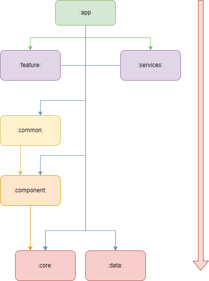

# Music Club Classic

**Music Club** — это приложение для стриминга музыки с сервиса YouTube. Оно позволяет находить и воспроизводить треки с популярной платформы, а также сохранять любимые треки и альбомы.

## 📚 Цель проекта
Приложение демонстрирует мои навыки в Android-разработке с использованием популярных технологий. Оно также служит примером применения архитектурных паттернов для создания качественного программного обеспечения.

## 📱 Скриншоты

## 👀 Функционал
1. Поиск и воспроизведение треков с YouTube.
2. Просмотр страниц авторов.
3. Просмотр новых альбомов.
4. Добавление треков в очередь воспроизведения.
5. Фоновое воспроизведение треков.
6. Режим «бесконечной музыки».

## 🧹 Стек технологий
- **Kotlin**
- **Dagger Hilt**
- **Glide**
- **ExoPlayer**
- **Kotlin Coroutines** 
- **Navigation Component**
- **Room**

## 🏠 Архитектура
Проект построен с использованием принципов **Clean Architecture** и паттерна **MVVM**.

Приложение разработано в многомодульной структуре, чтобы:
- Лучше контролировать архитектуру.
- Упрощать рефакторинг и добавление нового функционала.
- Минимизировать повторение кода.
- Получения опыта в многомодульном проекте.

**Модули проекта:**
- `:app` — главный модуль приложения.
- `:feature:` — модули, отвечающие за отдельные экраны.
- `:data:` — модули для работы с данными.
- `:common:` — вспомогательные инструменты (обработчики, делегаты, шаблоны экранов).
- `:core:` — базовые компоненты (темы, утилиты, адаптеры).
- `:component:` — кастомные элементы интерфейса.
- `:service:` — фоновые сервисы.

### Диаграмма модулей

## 🔧 Сборка
Для сборки проекта не требуется специальных действий:
1. Скачайте проект.
2. Откройте его в **Android Studio**.
3. Запустите сборку.

## 🌐 Планы на будущее
1. Улучшить производительность и оптимизацию приложения.
2. Покрыть проект автоматическими тестами.
3. Добавить возможность создания и редактирования плейлистов.
4. Реализовать расширенный поиск с фильтрацией по различным параметрам.
5. Интегрировать трансляцию музыки через Discord-бота.

